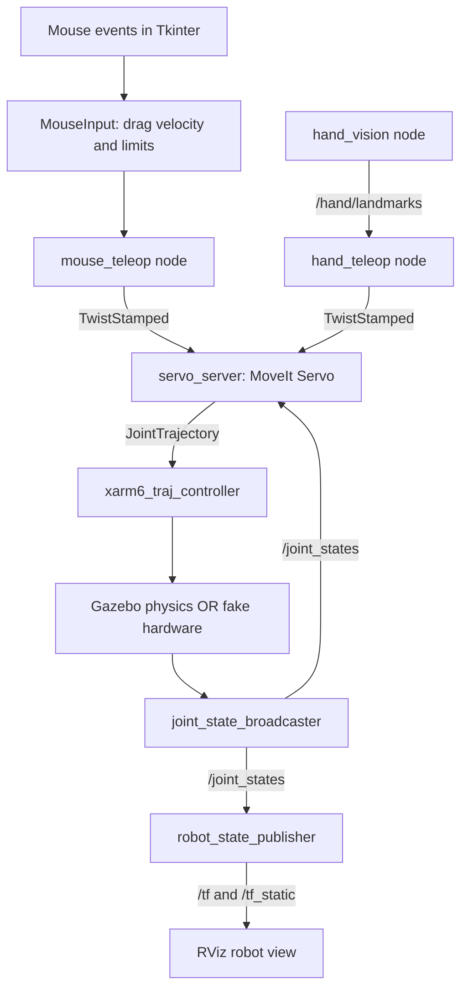
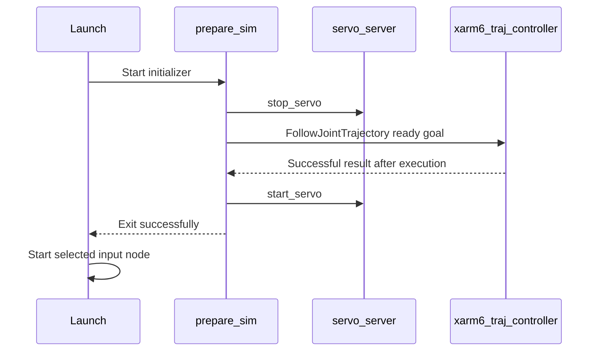

# Teleoperation architecture

This document describes the current xArm 6 teleoperation implementation:
mouse and hand input, MoveIt Servo, the joint controller, and the two simulation
backends. For a shorter operating guide, see [README.md](README.md).

## 1. System overview

The input node requests Cartesian tool velocity. MoveIt Servo converts that
request into joint trajectories using the robot model and current joint state.
The trajectory controller executes those commands through the chosen simulation
backend. RViz displays the resulting robot state.



Mouse and hand input are alternatives. Run one selected input source and one
simulation backend at a time; they share the same command topics and controller
names. The fake vendor launch also includes joystick input components, although
the mouse demo does not use a joystick.

## 2. Code and package boundaries

| Location | Responsibility |
| --- | --- |
| [mouse_teleop_node.py](hand_teleop/mouse_teleop_node.py) | Mouse mapping, Tkinter window, velocity publication, and input stopping |
| [teleop_node.py](hand_teleop/teleop_node.py) | Hand wrist-offset mapping and tracking freshness checks |
| [setup.py](setup.py) | Registers the `mouse_teleop_node` and `teleop_node` executables |
| [test_mouse_input.py](test/test_mouse_input.py) | Deterministic tests of mouse mapping and input state |
| [sim.launch.py](../hand_bringup/launch/sim.launch.py) | Fake-hardware stack and hand/mouse input selection |
| [gazebo.launch.py](../hand_bringup/launch/gazebo.launch.py) | Gazebo Classic stack, Servo configuration, and optional viewers |
| [prepare_sim.py](../hand_bringup/hand_bringup/prepare_sim.py) | Completes a ready-pose trajectory before enabling input |
| [mouse.rviz](../hand_bringup/config/mouse.rviz) | RViz view of the Gazebo arm's joint feedback |
| [launch_mouse_xarm.sh](../../../scripts/launch_mouse_xarm.sh) | Sources ROS, starts the VNC desktop, and launches fake-hardware mouse control |
| [launch_mouse_gazebo.sh](../../../scripts/launch_mouse_gazebo.sh) | Sources ROS, starts the VNC desktop, and launches Gazebo mouse control |
| [Servo configuration](../xarm_ros2/xarm_moveit_servo/config/xarm_moveit_servo_config.yaml) | Servo timing, frames, topics, filtering, and motion constraints |

`hand_teleop` owns input interpretation. `hand_bringup` connects the input to
simulation. The vendor `xarm_ros2` packages supply the robot description,
controller configuration, and simulation integration. MoveIt Servo supplies the
Cartesian-to-joint conversion; this package contains no custom IK solver.

## 3. ROS interface

Names below assume the current unprefixed, non-namespaced xArm 6 launch.

| Topic or endpoint | Type | Producer → consumer |
| --- | --- | --- |
| `/hand/landmarks` | `hand_interfaces/msg/HandLandmarks` | `hand_vision` → `hand_teleop` |
| `/servo_server/delta_twist_cmds` | `geometry_msgs/msg/TwistStamped` | Selected input → Servo |
| `/xarm6_traj_controller/joint_trajectory` | `trajectory_msgs/msg/JointTrajectory` | Servo → trajectory controller |
| `/joint_states` | `sensor_msgs/msg/JointState` | Joint state broadcaster → Servo and robot state publisher |
| `/tf`, `/tf_static` | `tf2_msgs/msg/TFMessage` | Transform publishers → viewers and other transform consumers |
| `/servo_server/status` | `std_msgs/msg/Int8` | Servo → diagnostics |
| `/clock` | `rosgraph_msgs/msg/Clock` | Gazebo → nodes using simulation time |
| `/servo_server/stop_servo` | `std_srvs/srv/Trigger` service | Initializer → Servo |
| `/servo_server/start_servo` | `std_srvs/srv/Trigger` service | Initializer → Servo |
| `/xarm6_traj_controller/follow_joint_trajectory` | `control_msgs/action/FollowJointTrajectory` action | Initializer → trajectory controller |

Each input command has a fresh ROS timestamp and `header.frame_id = 'link_base'`.
Linear velocity is in meters/second. Angular velocity remains zero, so mouse
control requests translation without requesting tool rotation. X, Y, and Z are
robot-base directions, independent of the viewer's camera angle.

## 4. Mouse input and drag-speed mapping

### Input state

`MouseInput` contains the mapping and can be tested without creating a window.
`MouseTeleop`, a ROS node named `mouse_teleop`, owns the window and publisher.

1. Pressing the left button inside the pad records the pointer reference and
   arms the input. Clicking alone requests no movement.
2. Motion events accumulate horizontal and vertical pixel displacement.
3. Each publication tick divides that displacement by elapsed monotonic time.
4. The mapping selects the Cartesian axes and caps total translation speed.
5. The accumulated displacement is cleared after consumption. A stationary
   pointer therefore requests zero on the next tick, even while held.

Mouse movement is measured inside the control pad; this is not a global desktop
mouse hook. Release and reposition the pointer when another stroke is needed.
The crosshair is visual guidance, not a neutral zone or speed reference.

### Equations and axis selection

For pixel displacement `du`, `dv`, elapsed time `dt`, and gain `g`:

```text
horizontal_speed = -du * g / dt
vertical_speed   = -dv * g / dt

Without Shift: (vx, vy, vz) = (0, horizontal_speed, vertical_speed)
With Shift:    (vx, vy, vz) = (vertical_speed, horizontal_speed, 0)

speed = sqrt(vx² + vy² + vz²)
output_velocity = requested_velocity * min(1, max_speed / speed)
                  # A zero vector remains zero.
```

Screen coordinates increase rightward and downward. Consequently, dragging
right requests negative Y; dragging up requests positive Z, or positive X with
Shift. Switching Shift mode discards pending displacement, preventing a stroke
measured for Z from being replayed as X. Horizontal displacement accumulated
before the switch is also discarded.

The working mouse launch defaults are:

| Setting | Value | Meaning |
| --- | --- | --- |
| `mouse_gain` | `0.001` meters/pixel | 100 pixels/second requests 0.1 m/s |
| `max_speed` | `0.25` m/s | Caps the length of the full X/Y/Z velocity vector |
| GUI publication interval | 50 ms | Nominal 20 Hz command stream |
| GUI stall threshold | 0.2 s | Disarms input if publication stalls too long |

A 100-pixel stroke requests approximately 10 cm of travel before speed limiting,
Servo filtering, and simulation execution. This is a velocity command, not an
exact displacement guarantee. Filtering, different update rates, joint limits,
singularities, and collision proximity can reduce actual movement.

### Stopping and event-loop behavior

| Event | Behavior |
| --- | --- |
| Pointer stops moving | Next tick requests zero; input remains armed |
| Button release, pointer leaves pad, or window loses focus | Immediately requests zero, clears input, and requires another click |
| Event loop stalls more than 0.2 s | Disarms before normal publication resumes |
| Escape or window close | Requests zero and exits the mouse node |
| Entire command stream disappears | Servo's configured incoming-command timeout is 0.2 s |

Tkinter schedules publication through `root.after(50, tick)`. The same event loop
handles mouse events and calls nonblocking `rclpy.spin_once`. A frozen GUI cannot
continue publishing a held velocity from an independent publisher thread.
The mouse uses `time.monotonic()` for drag measurement, while message timestamps
use the ROS clock. These clocks serve different purposes.

## 5. Hand input path

The existing `hand_teleop` node uses wrist **position offset**, rather than mouse
drag velocity. At 20 Hz it reads landmark index 0, subtracts image center
`(0.5, 0.5)`, and maps horizontal/vertical offsets to negative Y/Z velocity.
X and all angular velocity components remain zero.

Its defaults are gain `0.25`, deadband `0.05`, per-axis speed cap `0.05 m/s`, and
tracking freshness threshold `0.2 s`. Missing, untracked, or stale input produces
zero commands. Its per-axis cap differs from the mouse's total-vector cap.

The fake-hardware launch starts `hand_vision` only in hand mode. The current
vision node defaults to synthetic landmarks at 30 Hz; its real-camera class is
still a `NotImplementedError` placeholder. The dedicated Gazebo launch currently
starts mouse input only.

## 6. Servo, inverse kinematics, and execution

Input nodes do not choose joint angles. Servo receives Cartesian velocity,
combines it with the robot description and current joints, and produces joint
trajectory commands. The controller then executes those joint commands.

The shared Servo YAML has `command_in_type: speed_units`, so commands are already
in physical units. The `scale.linear` setting is used for unitless input and
does not increase the speed of these mouse commands. Tune `mouse_gain` and
`max_speed` instead.

Other relevant configured values are a `0.067 s` Servo publish period (about
15 Hz), collision checks at 10 Hz, and singularity slowdown/stop thresholds of
17 and 30. Joint position output is enabled; joint velocity and acceleration
output are disabled. Each launch overrides the YAML's generic xArm 7 group and
output topic for xArm 6.

The separate pose-planning stack uses `xarm_planner_node` and MoveIt's
`move_group` interface. The xArm 6 [kinematics configuration](../xarm_ros2/xarm_moveit_config/config/xarm6/kinematics.yaml)
selects `kdl_kinematics_plugin/KDLKinematicsPlugin`; that solver is a loaded
plugin, not a standalone ROS node. The mouse demos stream directly to Servo and
do not require calling the planner's pose-planning services.

## 7. Simulation backends and startup

| Detail | Fake-hardware demo | Gazebo demo |
| --- | --- | --- |
| Launch | `hand_bringup sim.launch.py` | `hand_bringup gazebo.launch.py` |
| Input selection | `input_mode:=hand` or `mouse` | Mouse |
| Hardware plugin | `uf_robot_hardware/UFRobotFakeSystemHardware` | `gazebo_ros2_control/GazeboSystem` |
| Controller manager | Separate `ros2_control_node` | Owned by Gazebo's control plugin |
| Physics | No Gazebo physics | Gazebo Classic world |
| ROS clock | Default ROS clock | Gazebo `/clock` with `use_sim_time=true` |
| View | Vendor Servo RViz configuration | RViz by default; native Gazebo client optional |

Gazebo uses the vendor table world, with its existing physics settings, including
the world's zero-gravity setting. It is not a gravity/load validation setup.
RViz displays Gazebo joint feedback; it does not execute the physics itself.
The native Gazebo client currently hangs before opening a window in this
container, so `gui` defaults to `false`, and `show_rviz` defaults to `true`.

### Ready-pose initialization

The all-zero joint pose is singular for Servo. `prepare_sim` performs this
sequence before either input node is enabled:



The target for `joint1` through `joint6`, in radians, is
`[0.0, -0.3, -0.5, 0.0, 0.8, 0.0]`, with a three-second trajectory duration.
Servo is stopped during this move so its hold trajectories cannot override
initialization. Service/action availability and results have 90-second waits.
Failure causes launch shutdown instead of enabling teleoperation.

The fake launch delays initializer startup by six seconds. Gazebo starts it
alongside the simulator and relies on service/action readiness. Startup duration
therefore depends on the backend and host; the launch waits for completion
rather than assuming that the arm is ready after a fixed delay.

## 8. Build, run, and tune

Run from the repository root inside the ROS Humble development container:

```bash
cd /workspace
source /opt/ros/humble/setup.bash
source ros_ws/install/setup.bash
cd ros_ws
colcon build --symlink-install --packages-select hand_teleop hand_bringup
cd /workspace

# Choose one:
bash scripts/launch_mouse_gazebo.sh
# bash scripts/launch_mouse_xarm.sh
```

The scripts start the VNC desktop on display `:1`. Connect at
<http://localhost:6080/vnc.html>, forwarding port 6080 from VS Code if necessary.
Stop the launcher with Ctrl+C before starting another backend.

Override settings at launch:

```bash
bash scripts/launch_mouse_gazebo.sh mouse_gain:=0.0015 max_speed:=0.3
# Optional native client on a desktop where it works:
bash scripts/launch_mouse_gazebo.sh gui:=true
```

The mouse node reads these parameters at construction; changing ROS parameters
later does not update its `MouseInput` object. Restart with launch arguments to
apply a different gain or cap.

There is one default distinction to preserve: `sim.launch.py` itself defaults
to hand mode with `max_speed:=0.05`. The fake **mouse wrapper** explicitly selects
mouse mode and overrides the cap to `0.25`. For the same mouse settings when
launching directly, use:

```bash
ros2 launch hand_bringup sim.launch.py input_mode:=mouse max_speed:=0.25 mouse_gain:=0.001
```

## 9. Verification and troubleshooting

Run the input-mapping tests from the repository root after sourcing ROS and the
workspace:

```bash
/usr/bin/python3 -m pytest ros_ws/src/hand_teleop/test/test_mouse_input.py -q
```

The current suite has 19 parameterized cases covering inactive input, click
behavior, proportional drag speeds, event frequency, elapsed time, stationary
stopping, Shift switching, diagonal limits, disarming, stalled input, and invalid
gain/speed settings. These tests do not launch or validate the physics backend.

Live Gazebo checks during development separately verified joint movement,
faster commands for faster drags, X/Y/Z selection, release-to-stop, and stopping
on pad exit. Exact tool travel is not guaranteed by those input tests.

| Symptom | Useful check |
| --- | --- |
| No mouse window yet | Look for initializer success or failure in the launch terminal |
| Commands exist but arm does not move | Check `/servo_server/status`, controller activation, and `/joint_states` |
| Arm feels slow | Inspect requested velocities; compare `mouse_gain`, total speed cap, and Servo status |
| RViz visible but no Gazebo window | Expected with `gui:=false`; Gazebo physics still runs |
| Browser desktop unavailable | Check port 6080 forwarding and `.devcontainer/start-vnc.sh` |
| Competing or erratic commands | Stop other hand, mouse, joystick, or test publishers |

Useful ROS diagnostics include:

```bash
ros2 node list
ros2 topic echo /servo_server/delta_twist_cmds
ros2 topic echo /servo_server/status
ros2 topic echo /joint_states
ros2 control list_controllers
```

## 10. Current boundaries

The simulation wrappers do not connect to a physical arm. The separate
`launch_mouse_hardware.sh [ROBOT_IP]` wrapper starts `hardware_mouse.launch.py`
with `uf_robot_hardware/UFRobotSystemHardware`, a joint state broadcaster,
MoveIt Servo, and mouse input. It uses wall-clock ROS time and no joystick.
`prepare_hardware` waits for active controllers and fresh six-joint feedback,
then starts Servo before opening the mouse pad; it sends no ready-pose move.
Hardware defaults are 0.05 m/s and 0.0001 m/pixel. Driver activation enables
motors and selects Servo mode. See the README for connection instructions and
physical validation limits. Mouse control requests translation only, operates within its pad,
and has no independent workspace-boundary planner. Servo checks its configured
robot/planning scene, but Gazebo world objects are not automatically mirrored
into MoveIt's collision scene by this launch. The physical world's contacts and
MoveIt's collision checks are separate mechanisms.

When extending the package, keep input mapping in `MouseInput`, window and ROS
integration in `MouseTeleop`, backend wiring in `hand_bringup`, and vendor robot
configuration in the corresponding `xarm_ros2` packages.


### Hardware address discovery

Omitting the address selects `robot_ip:=auto`. `discover_xarm.py` enumerates
private wired IPv4 LANs (/24 or smaller, at most 1024 candidate addresses),
then sends the SDK GET_VERSION request to port 502 with bounded concurrent
connections. It checks transaction, protocol, length, function, and xArm 6 model
fields. Only one match is accepted; no match or ambiguous results abort before
hardware actions are constructed. Discovery is read-only and uses no motor or
motion commands. Explicit IPs bypass discovery. Container networking must expose
the arm subnet for discovery; it cannot configure the host's Ethernet interface.
